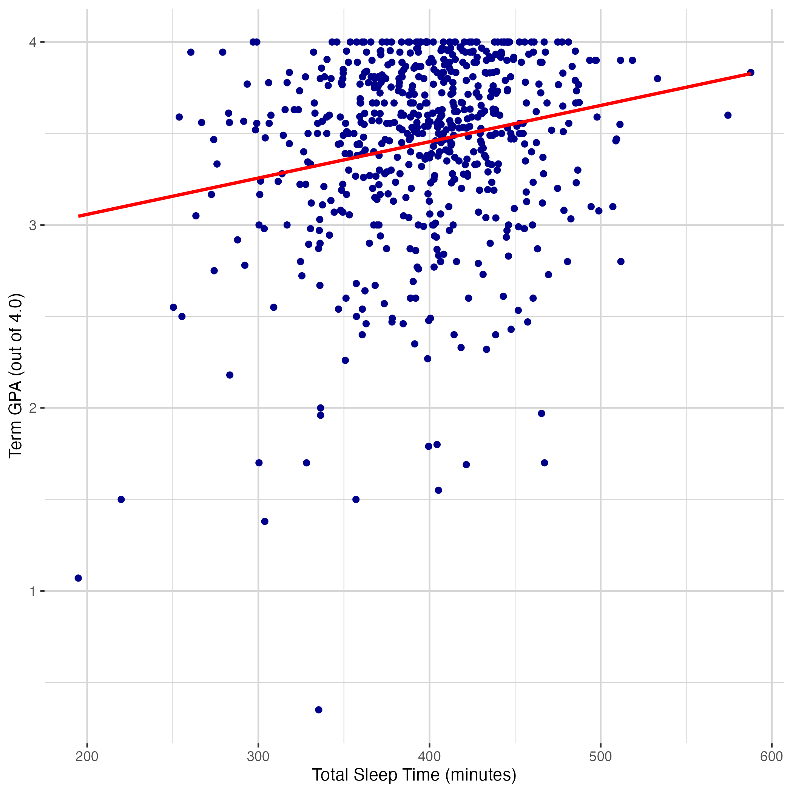

```{=html}
<link rel="stylesheet" href="https://cdn.jsdelivr.net/npm/bootstrap-icons@1.11.3/font/bootstrap-icons.css">
<link href="https://fonts.googleapis.com/css2?family=Fraunces:wght@400;500;600;700&family=Inter:wght@400;500;600;700&display=swap" rel="stylesheet">

<style>
:root {
  --bg: #f4f4f4;
  --black: #111;
  --white: #ffffff;
  --purple: #D85CDB;
  --green: #b7ff91;
}

html, body { margin: 0; padding: 0; }
body { background: var(--bg); overflow-x: hidden; color: var(--black); }

#quarto-content, #quarto-document-content, .page-columns, .content, main.content {
  width: 100% !important;
  max-width: 100% !important;
  margin: 0 !important;
}
main.content { padding: 0 !important; }
.quarto-title-block { display: none !important; }

/* ---------------- PAGE ---------------- */

.poster-page {
  width: min(1100px, calc(100vw - 1rem));
  margin: 1rem auto 0;
  padding: 3rem 2rem 3rem;
  box-sizing: border-box;
  font-family: "Inter", sans-serif;
  color: var(--black);
}

/* ---------------- HEADER ---------------- */

.poster-header {
  text-align: center;
  max-width: 860px;
  margin: 0 auto 4.5rem;
}

.poster-header h1 {
  font-family: "Fraunces", serif;
  font-size: clamp(1.8rem, 3vw, 2.45rem);
  line-height: 1.08;
  font-weight: 400;
  margin: 0 0 1rem;
}

.poster-header p {
  font-size: 0.95rem;
  line-height: 1.3;
  max-width: 660px;
  margin: 0 auto 0.8rem;
}

.poster-date { font-size: 0.9rem; margin-bottom: 1.6rem; }

.nav-buttons { display: flex; justify-content: center; gap: 1.2rem; }

.nav-buttons a {
  color: var(--black);
  text-decoration: none;
  font-size: 1.15rem;
  width: 2.8rem;
  height: 2.8rem;
  display: inline-flex;
  align-items: center;
  justify-content: center;
  border: 2px solid var(--black);
  border-radius: 999px;
  background: var(--white);
  box-shadow: 5px 5px 0 var(--green);
  transition: transform 0.18s ease, box-shadow 0.18s ease, background 0.18s ease;
}

.nav-buttons a:hover {
  color: var(--black);
  background: var(--green);
  box-shadow: 5px 5px 0 var(--purple);
  transform: translateY(-2px);
}

.nav-buttons i { line-height: 1; }

/* ---------------- SECTIONS (no boxes) ---------------- */

.poster-section {
  width: 100%;
  max-width: 920px;
  margin: 0 auto 5rem;
}

.section-heading {
  display: flex;
  align-items: center;
  justify-content: center;
  gap: 1rem;
  margin: 0 auto 2rem;
  font-family: "Fraunces", serif;
  font-size: clamp(1.5rem, 2.55vw, 2.25rem);
  font-weight: 400;
  line-height: 1.1;
  text-align: center;
  border: none;
  text-decoration: none;
}

.section-heading img { width: 48px; height: 48px; object-fit: contain; }

.section-text p {
  font-size: 1rem;
  line-height: 1.6;
  margin: 0 0 1rem;
}

.section-text p:last-child { margin-bottom: 0; }

.section-text ul { padding-left: 1.2rem; margin: 1rem 0 0; }
.section-text li { font-size: 1rem; line-height: 1.55; margin-bottom: 0.7rem; }

.question-text {
  font-family: "Fraunces", serif;
  font-size: 1.4rem;
  line-height: 1.08;
  font-weight: 400;
  text-align: center;
  max-width: 760px;
  margin: 0 auto;
}

/* text + inline image */
.split {
  display: grid;
  grid-template-columns: 1.1fr 0.9fr;
  column-gap: 2.5rem;
  align-items: center;
}

.plot img {
  width: 100%;
  display: block;
  border-radius: 16px;
  object-fit: contain;
}

.method-text { max-width: 760px; margin: 0 auto; }

.results-split {
  grid-template-columns: 0.9fr 1.1fr;
  max-width: 880px;
  margin: 0 auto;
}

/* ---------------- STATS ---------------- */

.stat-row {
  display: grid;
  grid-template-columns: repeat(2, 1fr);
  gap: 3rem;
  max-width: 760px;
  margin: 0 auto 3rem;
  text-align: center;
}

.stat-number {
  font-family: "Fraunces", serif;
  font-size: clamp(2.2rem, 4.5vw, 3.4rem);
  line-height: 1;
  margin-bottom: 0.7rem;
}

.stat-number sup { font-size: 0.48em; vertical-align: super; line-height: 0; }

.stat p { font-size: 0.92rem; line-height: 1.4; margin: 0; }

/* ---------------- KEY FINDINGS (icon rows) ---------------- */

.finding-row {
  display: grid;
  grid-template-columns: 72px 1fr;
  gap: 1.3rem;
  align-items: center;
  margin: 0 auto 2rem;
}

.finding-icon {
  width: 58px;
  height: 58px;
  border-radius: 50%;
  background: #efffe8;
  display: flex;
  align-items: center;
  justify-content: center;
}

.finding-icon svg {
  width: 34px;
  height: 34px;
  stroke: var(--black);
  stroke-width: 2.3;
  fill: none;
  stroke-linecap: round;
  stroke-linejoin: round;
}

.finding-icon .purple-fill { fill: var(--purple); stroke: var(--black); }

.finding-label {
  margin: 0 0 0.35rem;
  font-size: 1.05rem;
  font-weight: 800;
  line-height: 1.15;
  text-decoration: none;
  pointer-events: none;
}

.finding-text p { margin: 0; font-size: 0.95rem; line-height: 1.5; }

/* ---------------- MOBILE ---------------- */

@media (max-width: 760px) {
  .poster-page { width: 100%; padding: 2rem 1rem 2rem; }
  .poster-header { margin-bottom: 3rem; }
  .poster-section { margin-bottom: 3.5rem; }
  .split, .results-split { grid-template-columns: 1fr; row-gap: 1.75rem; }
  .results-split .plot { max-width: 480px; margin: 0 auto; }
  .stat-row { grid-template-columns: 1fr; gap: 2rem; }
  .section-heading { gap: 0.75rem; margin-bottom: 1.5rem; }
  .section-heading img { width: 28px; height: 28px; }
  .finding-row { grid-template-columns: 52px 1fr; gap: 0.9rem; }
  .finding-icon { width: 48px; height: 48px; }
  .finding-icon svg { width: 29px; height: 29px; }
}
</style>

<div class="poster-page">

  <header class="poster-header">
    <h1>Exploring the Relationship Between Sleep Duration and College GPA</h1>
    <p>A statistical analysis examining whether college students’ average sleep duration is associated with semester GPA.</p>
    <div class="poster-date">October 2023</div>
    <nav class="nav-buttons">
      <a href="401.pdf" aria-label="Report" title="Report"><i class="bi bi-file-earmark-pdf"></i></a>
    </nav>
  </header>

  <!-- RESEARCH QUESTION -->
  <section class="poster-section">
    <div class="section-heading">
      
      <span>Research Question</span>
      
    </div>

    <div class="question-text">
      Is there an association between average sleep duration and academic performance among college students?
    </div>
  </section>

  <!-- METHODOLOGY -->
  <section class="poster-section">
    <div class="section-heading">
      
      <span>Methodology</span>
      
    </div>

    <div class="section-text method-text">
      <p>
        The analysis uses data from students at Carnegie Mellon University and two other universities, where students wore sleep trackers for one month during the spring semester. A simple linear regression was implemented in R to evaluate the association between sleep duration and academic performance. Based on exploratory data analysis, the model focused on students’ average nightly sleep time and semester GPA.
      </p>
      <ul>
        <li><strong>Simple Linear Regression:</strong> Models the association between TotalSleepTime and term_gpa.</li>
        <li><strong>Variable Transformation:</strong> TotalSleepTime was converted from minutes to hours (divided by 60), so the slope is the average GPA difference per additional hour of sleep.</li>
        <li><strong>Model Evaluation:</strong> The regression plot suggested a plausibly linear relationship, though visible variation around the fitted line indicated the model may not capture all patterns.</li>
      </ul>
    </div>
  </section>

  <!-- MODEL RESULTS -->
  <section class="poster-section">
    <div class="section-heading">
      
      <span>Model Results</span>
      
    </div>

    <div class="stat-row">
      <div class="stat">
        <div class="stat-number">0.1191</div>
        <p>Estimated GPA increase associated with one additional hour of sleep.</p>
      </div>
      <div class="stat">
        <div class="stat-number">3.04 × 10<sup>−7</sup></div>
        <p>P-value for the sleep duration coefficient, indicating statistical significance.</p>
      </div>
    </div>

    <div class="split results-split">
      <div class="plot">
        
      </div>

      <div class="section-text">
        <p>
          The fitted model found a positive slope estimate for sleep duration. The p-value was very small, providing evidence that the slope coefficient is not equal to zero.
        </p>
      </div>
    </div>
  </section>

  <!-- KEY FINDINGS -->
  <section class="poster-section">
    <div class="section-heading">
      
      <span>Key Findings</span>
      
    </div>

    <div class="finding-row">
      <div class="finding-icon">
        <svg viewBox="0 0 64 64" aria-hidden="true">
          <path d="M12 52h40"></path>
          <path d="M18 43c4-7 8-12 14-12s10 5 14 12"></path>
          <path d="M18 43c4 4 9 6 14 6s10-2 14-6"></path>
          <circle cx="32" cy="24" r="8"></circle>
          <path class="purple-fill" d="M32 7l2.4 5 5.5.8-4 3.9.9 5.5-4.8-2.6-4.8 2.6.9-5.5-4-3.9 5.5-.8L32 7z"></path>
        </svg>
      </div>
      <div class="finding-text">
        <div class="finding-label">Positive Association</div>
        <p>Students who slept more tended to have higher semester GPAs on average, suggesting a positive relationship between sleep duration and academic performance.</p>
      </div>
    </div>

    <div class="finding-row">
      <div class="finding-icon">
        <svg viewBox="0 0 64 64" aria-hidden="true">
          <path d="M12 52h40"></path>
          <rect x="16" y="39" width="7" height="13"></rect>
          <rect x="29" y="30" width="7" height="22"></rect>
          <rect x="42" y="19" width="7" height="33"></rect>
          <path class="purple-fill" d="M29 9h6v11h9l-12 14-12-14h9z"></path>
        </svg>
      </div>
      <div class="finding-text">
        <div class="finding-label">GPA Effect</div>
        <p>Each additional hour of sleep was associated with a 0.1191-point increase in GPA. Two fewer hours of sleep corresponded to an estimated 0.2382-point decrease in GPA.</p>
      </div>
    </div>

    <div class="finding-row">
      <div class="finding-icon">
        <svg viewBox="0 0 64 64" aria-hidden="true">
          <path d="M10 52h44"></path>
          <path d="M14 43l10-11 9 7 16-22"></path>
          <circle cx="14" cy="43" r="3.2" class="purple-fill"></circle>
          <circle cx="24" cy="32" r="3.2" class="purple-fill"></circle>
          <circle cx="33" cy="39" r="3.2" class="purple-fill"></circle>
          <circle cx="49" cy="17" r="3.2" class="purple-fill"></circle>
          <path d="M14 16h14"></path>
          <path d="M14 23h20"></path>
          <path d="M14 9h26"></path>
        </svg>
      </div>
      <div class="finding-text">
        <div class="finding-label">Correlation, Not Causation</div>
        <p>The model shows an association between sleep and GPA, but it does not prove that sleeping more directly causes a higher GPA.</p>
      </div>
    </div>
  </section>

</div>
```