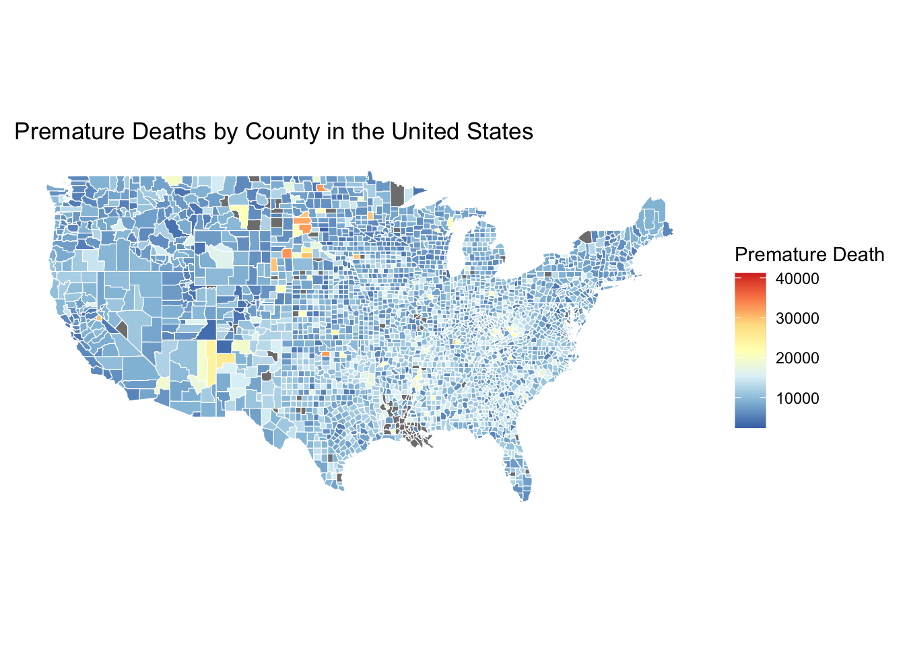
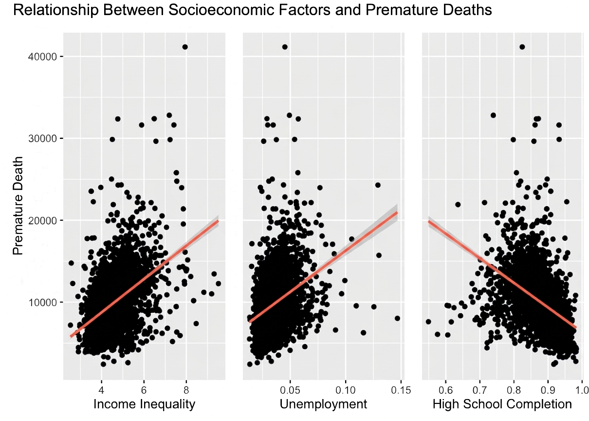

```{=html}
<link rel="stylesheet" href="https://cdn.jsdelivr.net/npm/bootstrap-icons@1.11.3/font/bootstrap-icons.css">
<link href="https://fonts.googleapis.com/css2?family=Fraunces:wght@400;500;600;700&family=Inter:wght@400;500;600;700&display=swap" rel="stylesheet">

<style>

:root {
  --bg: #f4f4f4;
  --black: #111;
  --white: #ffffff;
  --purple: #D85CDB;
  --green: #b7ff91;
  --soft-purple: #F7E8F8;
}

html,
body {
  margin: 0;
  padding: 0;
}

body {
  background: var(--bg);
  overflow-x: hidden;
  color: var(--black);
}

#quarto-content,
#quarto-document-content,
.page-columns,
.content,
main.content {
  width: 100% !important;
  max-width: 100% !important;
  margin: 0 !important;
}

main.content {
  padding: 0 !important;
  padding-bottom: 0 !important;
}

.quarto-title-block {
  display: none !important;
}

/* ---------------- POSTER CANVAS ---------------- */

.poster-page {
  width: min(1250px, calc(100vw - 1rem));
  min-height: auto;
  margin: 1rem auto 0;
  background: var(--bg);
  padding: 3rem 2rem 2rem;
  box-sizing: border-box;
  font-family: "Inter", sans-serif;
  color: var(--black);
}

/* ---------------- HEADER ---------------- */

.poster-header {
  text-align: center;
  max-width: 860px;
  margin: 0 auto 4.5rem;
}

.poster-header h1 {
  font-family: "Fraunces", serif;
  font-size: clamp(1.8rem, 3vw, 2.45rem);
  line-height: 1.08;
  font-weight: 400;
  margin: 0 0 1rem;
  letter-spacing: 0;
  color: var(--black);
}

.poster-header p {
  font-family: "Inter", sans-serif;
  font-size: 0.95rem;
  line-height: 1.45;
  max-width: 660px;
  margin: 0 auto 0.8rem;
  color: var(--black);
}

.poster-date {
  font-family: "Inter", sans-serif;
  font-size: 0.9rem;
  margin-bottom: 1.6rem;
  color: var(--black);
}

.nav-buttons {
  display: flex;
  justify-content: center;
  gap: 1.2rem;
}

.nav-buttons a {
  font-family: "Inter", sans-serif;
  color: var(--black);
  text-decoration: none;
  font-size: 1.15rem;
  width: 2.8rem;
  height: 2.8rem;
  display: inline-flex;
  align-items: center;
  justify-content: center;
  border: 2px solid var(--black);
  border-radius: 999px;
  background: var(--white);
  box-shadow: 5px 5px 0 var(--green);
  transition: transform 0.18s ease, box-shadow 0.18s ease, background 0.18s ease;
}

.nav-buttons a:hover {
  color: var(--black);
  background: var(--green);
  box-shadow: 5px 5px 0 var(--purple);
  transform: translateY(-2px);
}

.nav-buttons i {
  line-height: 1;
}

/* ---------------- FLOWER HEADINGS ---------------- */

.section-heading {
  display: flex;
  align-items: center;
  justify-content: flex-start;
  gap: 0.85rem;
  font-family: "Fraunces", serif;
  font-size: clamp(1.5rem, 2.55vw, 2.25rem);
  line-height: 1.1;
  font-weight: 400;
  color: var(--black);
  margin: 0 0 1.7rem;
  margin-top: 0 !important;
  border-bottom: none !important;
  padding-bottom: 0 !important;
}

.section-heading img {
  width: 32px;
  height: 32px;
  object-fit: contain;
  display: block;
  flex-shrink: 0;
}

.section-heading.centered {
  justify-content: center;
}

/* no hover anchor links on headings */
.anchorjs-link,
.section-heading .anchorjs-link,
.section-heading a {
  display: none !important;
}

/* ---------------- RESEARCH QUESTION ---------------- */

.research-question {
  display: grid;
  grid-template-columns: 0.85fr 1.15fr;
  gap: 3.5rem;
  align-items: center;
  margin-bottom: 2rem;
}

.question-copy {
  display: flex;
  flex-direction: column;
  justify-content: center;
  align-items: stretch;
  min-width: 0;
}

/* wrapper is exactly as wide as the heading (flower to flower),
   so the question text centers under the heading */
.question-block {
  width: fit-content;
  max-width: 100%;
  margin: 0 auto;
}

/* heading: title centered, flowers pinned to the left/right edges,
   so the box is perfectly symmetric around the title */
.question-block .section-heading {
  display: block;
  position: relative;
  text-align: center;
  margin-left: 0;
  margin-right: 0;
  padding-left: calc(32px + 0.85rem);
  padding-right: calc(32px + 0.85rem);
  box-sizing: border-box;
}

.question-block .section-heading span {
  white-space: nowrap;
}

.question-block .section-heading img {
  position: absolute;
  top: 50%;
  transform: translateY(-50%);
}

.question-block .section-heading img:first-of-type {
  left: 0;
}

.question-block .section-heading img:last-of-type {
  right: 0;
}

/* hide anything else the theme may inject into the heading */
.question-block .section-heading > :not(img):not(span),
.question-block .section-heading::before,
.question-block .section-heading::after {
  display: none !important;
}

.question-block .question-text {
  width: 0;
  min-width: 100%;
  text-align: center;
}

.question-text {
  font-family: "Fraunces", serif;
  font-size: clamp(1.05rem, 1.45vw, 1.28rem);
  line-height: 1.25;
  font-weight: 400;
  color: var(--black);
  margin: 0;
  width: 100%;
  text-align: center;
}

.map-panel {
  width: 100%;
  display: flex;
  align-items: center;
  justify-content: center;
}

.map-panel img {
  width: 100%;
  height: auto;
  display: block;
  object-fit: contain;
  border-radius: 20px;
}

/* ---------------- METHODOLOGY ---------------- */

.methodology-section {
  width: 100%;
  margin: 0 auto 6rem;
}

.methodology-content {
  display: grid;
  grid-template-columns: 1fr 1fr;
  gap: 3rem;
  align-items: center;
}

.methodology-text {
  font-family: "Inter", sans-serif;
  font-size: 1rem;
  line-height: 1.65;
  color: var(--black);
}

.methodology-text p {
  margin: 0 0 1.2rem;
}

.methodology-text ul {
  padding-left: 1.3rem;
  margin: 0 0 1.2rem;
}

.methodology-text li {
  margin-bottom: 0.7rem;
}

.methodology-image {
  width: 100%;
  display: flex;
  align-items: center;
  justify-content: center;
}

.methodology-image img {
  width: 100%;
  height: auto;
  display: block;
  object-fit: contain;
  border-radius: 20px;
}

/* ---------------- KEY FINDINGS ---------------- */

.key-findings-section {
  width: 100%;
  margin: 0 auto 6rem;
}

.findings-grid {
  display: grid;
  grid-template-columns: repeat(3, 1fr);
  gap: 3rem;
  align-items: start;
  margin-top: 2.5rem;
}

.finding {
  display: flex;
  flex-direction: column;
  align-items: center;
  text-align: center;
}

.key-finding-icon {
  width: 82px;
  height: 82px;
  border-radius: 50%;
  background: #efffe8;
  display: flex;
  align-items: center;
  justify-content: center;
  margin-bottom: 1.5rem;
  flex-shrink: 0;
}

.key-finding-icon svg {
  width: 43px;
  height: 43px;
  stroke: var(--black);
  stroke-width: 2.3;
  fill: none;
  stroke-linecap: round;
  stroke-linejoin: round;
}

.key-finding-icon .purple-fill {
  fill: var(--purple);
  stroke: var(--black);
}

.key-finding-label {
  font-family: "Fraunces", serif;
  font-size: 1.25rem;
  font-weight: 500;
  line-height: 1.2;
  margin: 0 0 0.8rem;
  color: var(--black);
}

.key-finding-text p {
  font-family: "Inter", sans-serif;
  font-size: 0.9rem;
  line-height: 1.55;
  color: var(--black);
  margin: 0;
}

/* ---------------- PRESENTATION / ACKNOWLEDGMENT ---------------- */

.presentation-row {
  width: 100%;
  display: flex;
  flex-direction: column;
  align-items: center;
  gap: 1.5rem;
  margin: 0 auto 2rem;
}

.presentation-row img {
  width: 100%;
  max-width: 520px;
  height: auto;
  display: block;
  object-fit: contain;
  border-radius: 20px;
}

.presentation-note {
  font-family: "Inter", sans-serif;
  font-size: 0.95rem;
  line-height: 1.6;
  color: var(--black);
  margin: 0;
  max-width: 700px;
  text-align: center;
}

/* ---------------- MOBILE ---------------- */

@media (max-width: 760px) {

  .poster-page {
    width: 100%;
    margin: 0;
    padding: 2rem 1.2rem 1.5rem;
    min-height: auto;
  }

  .poster-header {
    margin-bottom: 3rem;
  }

  .poster-header h1 {
    font-size: 1.8rem;
  }

  .nav-buttons {
    gap: 0.9rem;
    flex-wrap: wrap;
  }

  .section-heading {
    font-size: 1.65rem;
    gap: 0.65rem;
    margin-bottom: 1.3rem;
  }

  .section-heading img {
    width: 25px;
    height: 25px;
  }

  .research-question {
    grid-template-columns: 1fr;
    gap: 1.7rem;
    margin-bottom: 4.5rem;
  }

  .question-text {
    font-size: 1.12rem;
  }

  .map-panel img {
    width: 100%;
  }

  .methodology-section {
    margin-bottom: 4.5rem;
  }

  .methodology-content {
    grid-template-columns: 1fr;
    gap: 1.5rem;
  }

  .methodology-text {
    font-size: 0.92rem;
  }

  .methodology-image img {
    width: 100%;
  }

  .key-findings-section {
    margin-bottom: 4.5rem;
  }

  .findings-grid {
    grid-template-columns: 1fr;
    gap: 2.5rem;
    margin-top: 2rem;
  }

  .key-finding-icon {
    width: 72px;
    height: 72px;
    margin-bottom: 1rem;
  }

  .key-finding-icon svg {
    width: 38px;
    height: 38px;
  }

  .key-finding-label {
    font-size: 1.2rem;
  }

  .key-finding-text p {
    font-size: 0.88rem;
    max-width: 420px;
  }

  .presentation-note {
    font-size: 0.88rem;
  }

}

</style>

<div class="poster-page">

  <header class="poster-header">

    <h1>Examining the Influence of Socioeconomic Factors on Premature Death Rates Across Racial Groups</h1>

    <p>
      A statistical investigation into county-level predictors of health disparities, utilizing Gradient Boosted Trees and Linear Regression to identify key social determinants of health.
    </p>

    <div class="poster-date">August 2024</div>

    <nav class="nav-buttons">
      <a href="https://www.stat.cmu.edu/cmsac/sure/2024/showcase/premature_deaths/slides.pdf" aria-label="Slides" title="Slides">
        <i class="bi bi-laptop"></i>
      </a>

      <a href="https://www.stat.cmu.edu/cmsac/sure/2024/showcase/premature_deaths/poster.pdf" aria-label="Poster" title="Poster">
        <i class="bi bi-file-earmark-image"></i>
      </a>

      <a href="https://www.stat.cmu.edu/cmsac/sure/2024/showcase/premature_deaths/report.html" aria-label="Report" title="Report">
        <i class="bi bi-pencil"></i>
      </a>
    </nav>

  </header>


  <main class="poster-content">

    <!-- RESEARCH QUESTION -->

    <section class="research-question">

      <div class="question-copy">

        <div class="question-block">

          <h2 class="section-heading centered">
            
            <span>Research Question</span>
            
          </h2>

          <p class="question-text">
            How do social determinants of health shape premature death rates across racial groups in the United States?
          </p>

        </div>

      </div>

      <div class="map-panel">
        
      </div>

    </section>


    <!-- METHODOLOGY -->

    <section class="methodology-section">

      <h2 class="section-heading centered">
        
        <span>Methodology</span>
        
      </h2>

      <div class="methodology-content">

        <div class="methodology-text">

          <p>
           The study utilized data from the County Health Rankings data set. Statistical modelings methods were implemented using R   evaluate relationships between mortality and various Social Determinants of Health (SDOH). Based on exploratory data analysis, two distinct modeling approaches were chosen to be compared:
          </p>

          <ul>
Observe direct linear relationships between SDOH variables and the outcome.</li>
            <li><strong>Gradient Boosted Trees:</strong> Capture non-linear relationships between variables.</li>
          </ul>

          <p>

        </div>

        <div class="methodology-image">
          
        </div>

      </div>

    </section>


    <!-- KEY FINDINGS -->

    <section class="key-findings-section">

      <h2 class="section-heading centered">
        
        <span>Key Findings</span>
        
      </h2>

      <div class="findings-grid">

        <!-- FINDING 1 -->

        <div class="finding">

          <div class="key-finding-icon">
            <svg viewBox="0 0 64 64" aria-hidden="true">
              <circle cx="24" cy="29" r="5.5"></circle>
              <circle cx="40" cy="29" r="5.5"></circle>
              <circle cx="32" cy="22" r="6"></circle>
              <path d="M14 49c1.3-8 6.5-12.5 13-12.5"></path>
              <path d="M50 49c-1.3-8-6.5-12.5-13-12.5"></path>
              <path d="M22 51c1-9 6-14.5 10-14.5s9 5.5 10 14.5"></path>
              <path class="purple-fill" d="M32 13s-6.5-3.8-6.5-8.2c0-2.3 1.7-4 4-4 1.3 0 2.5.7 3.2 1.9C33.4 1.5 34.6.8 36 .8c2.3 0 4 1.7 4 4C40 9.2 32 13 32 13z"></path>
            </svg>
          </div>

          <div class="key-finding-text">
            <h3 class="key-finding-label">Socioeconomic Impact</h3>
            <p>
              Higher income inequality and unemployment were linked to more years of premature death (earlier deaths). Higher high school completion rates are linked to fewer years of premature deaths.
            </p>
          </div>

        </div>


        <!-- FINDING 2 -->

        <div class="finding">

          <div class="key-finding-icon">
            <svg viewBox="0 0 64 64" aria-hidden="true">
              <path d="M12 52h40"></path>
              <rect x="16" y="37" width="7" height="15"></rect>
              <rect x="29" y="28" width="7" height="24"></rect>
              <rect x="42" y="18" width="7" height="34"></rect>
              <path class="purple-fill" d="M28 8.5l3 6.1 6.7 1-4.9 4.8 1.2 6.8-6-3.2-6 3.2 1.2-6.8-4.9-4.8 6.7-1 3-6.1z"></path>
            </svg>
          </div>

          <div class="key-finding-text">
            <h3 class="key-finding-label">Variable Importance</h3>
            <p>
              Multiple linear regression identified AIAN population percentage as the most important variable, likely due to the model's sensitivity to this group's small population percentages across the U.S.
            </p>
          </div>

        </div>


        <!-- FINDING 3 -->

        <div class="finding">

          <div class="key-finding-icon">
            <svg viewBox="0 0 64 64" aria-hidden="true">
              <path d="M10 52h44"></path>
              <path d="M14 43l10-11 9 7 16-22"></path>
              <circle cx="14" cy="43" r="3.2" class="purple-fill"></circle>
              <circle cx="24" cy="32" r="3.2" class="purple-fill"></circle>
              <circle cx="33" cy="39" r="3.2" class="purple-fill"></circle>
              <circle cx="49" cy="17" r="3.2" class="purple-fill"></circle>
              <path d="M14 16h14"></path>
              <path d="M14 23h20"></path>
              <path d="M14 9h26"></path>
            </svg>
          </div>

          <div class="key-finding-text">
            <h3 class="key-finding-label">Model Performance</h3>
            <p>
              Cross-validation showed the gradient boosted tree captured relationships in the data that multiple linear regression did not.
            </p>
          </div>

        </div>

      </div>

    </section>


    <!-- PRESENTATION / ACKNOWLEDGMENT -->

    <section class="presentation-row">

      

      <p class="presentation-note">
        This research was conducted as part of the Carnegie Mellon Summer Undergraduate Research Experience (SURE) program in partnership with UnitedHealth Group.
      </p>

    </section>

  </main>

</div>
```