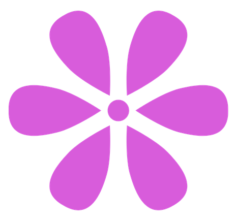
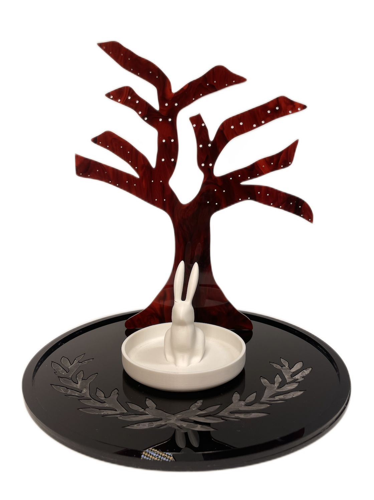
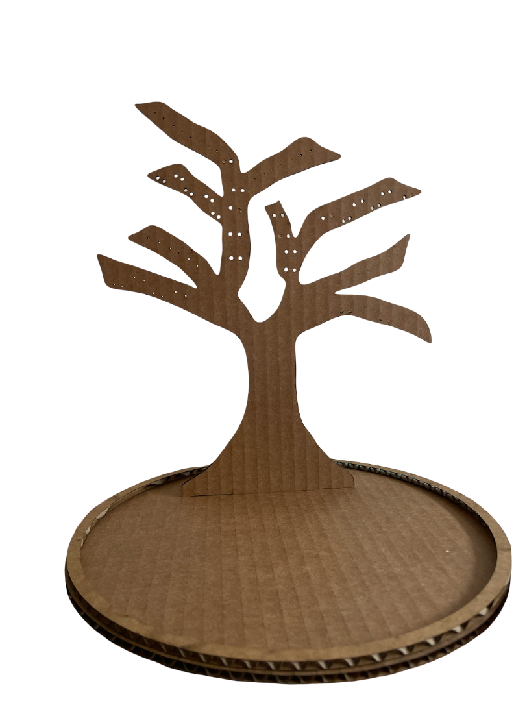
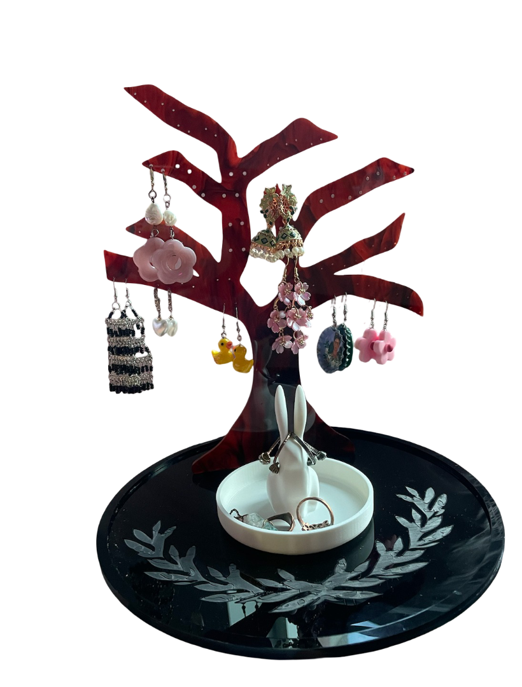

---
title: "Trinket Tree!"
description: "A digitally fabricated jewelry holder designed to organize earrings while functioning as a decorative object."
image: prof.png
date: December 2024
page-layout: full

format:
  html:
    theme: cosmo

resources:
  - prof.png
  - inuse.png
  - cardboard.png
  - "final project v0.stl"
---

```{=html}
<link href="https://fonts.googleapis.com/css2?family=Fraunces:wght@400;500;600;700&family=Inter:wght@400;500;600;700&display=swap" rel="stylesheet">

<style>

:root {
  --bg: #f4f4f4;
  --black: #111;
  --white: #ffffff;
  --purple: #D85CDB;
  --green: #b7ff91;
  --soft-green: #eaffde;
  --soft-purple: #F2D5F3;
}

html,
body {
  margin: 0;
  padding: 0;
}

body {
  background: var(--bg);
  overflow-x: hidden;
  color: var(--black);
}

#quarto-content,
#quarto-document-content,
.page-columns,
.content,
main.content {
  width: 100% !important;
  max-width: 100% !important;
  margin: 0 !important;
}

main.content {
  padding: 0 !important;
  padding-bottom: 0 !important;
}

.quarto-title-block {
  display: none !important;
}

.anchorjs-link,
.header-anchor,
a.anchorjs-link {
  display: none !important;
}

/* ---------------- POSTER CANVAS ---------------- */

.poster-page {
  width: min(1250px, calc(100vw - 1rem));
  min-height: auto;
  margin: 1rem auto 0;
  background: var(--bg);
  padding: 3rem 2rem 1rem;
  box-sizing: border-box;
  font-family: "Inter", sans-serif;
  color: var(--black);
}

/* ---------------- HEADER ---------------- */

.poster-header {
  text-align: center;
  max-width: 860px;
  margin: 0 auto 3.5rem;
}

.poster-header h1 {
  font-family: "Fraunces", serif;
  font-size: clamp(1.8rem, 3vw, 2.45rem);
  line-height: 1.08;
  font-weight: 400;
  margin: 0 0 1rem;
  letter-spacing: 0;
  color: var(--black);
}

.poster-header p {
  font-family: "Inter", sans-serif;
  font-size: 0.95rem;
  line-height: 1.18;
  max-width: 660px;
  margin: 0 auto 0.8rem;
  color: var(--black);
}

.poster-date {
  font-family: "Inter", sans-serif;
  font-size: 0.9rem;
  margin-bottom: 0;
  color: var(--black);
}

/* ---------------- MAIN LAYOUT ---------------- */

.poster-grid {
  display: grid;
  grid-template-columns: repeat(2, minmax(0, 1fr));
  column-gap: 2.5rem;
  row-gap: 4.5rem;
  align-items: center;
}

/* ---------------- MINIMAL TEXT SECTIONS ---------------- */

.section-card,
.process-card-big {
  background: none;
  border: none;
  border-radius: 0;
  box-shadow: none;
  padding: 0;
  box-sizing: border-box;
  color: var(--black);
}

.section-heading {
  display: flex !important;
  align-items: center;
  justify-content: center;
  gap: 0.9rem;
  width: 100%;
  margin: 0 auto 1.25rem;
  padding: 0 !important;
  background: none !important;
  border: none !important;
  border-radius: 0 !important;
  box-shadow: none !important;
  text-decoration: none !important;
  background-image: none !important;
  font-family: "Fraunces", serif;
  font-size: clamp(1.45rem, 2.4vw, 1.85rem);
  font-weight: 400;
  line-height: 1;
  color: var(--black);
  text-align: center;
}

.section-heading img {
  width: 32px;
  height: 32px;
  object-fit: contain;
  flex-shrink: 0;
  display: block;
}

.section-card p,
.section-card li {
  font-family: "Inter", sans-serif;
  font-size: 1rem;
  line-height: 1.55;
  color: var(--black);
}

.section-card p {
  margin: 0;
}

/* ---------------- INLINE TEXT + PHOTO ROWS ---------------- */

.inline-feature-row {
  grid-column: 1 / -1;
  display: grid;
  grid-template-columns: 1.1fr 0.9fr;
  gap: 0;
  align-items: center;
  width: 100%;
  max-width: 1100px;
  margin: 0 auto;
}

.text-block {
  width: 100%;
  max-width: none;
  margin: 0;
  padding: 0 0.5rem 0 0;
  text-align: center;
  box-sizing: border-box;
}

.inline-photo-unboxed {
  display: flex;
  align-items: center;
  justify-content: flex-start;
  height: 340px;
  width: 100%;
  max-width: none;
  margin: 0;
  overflow: visible;
  box-sizing: border-box;
  transform: translateX(-35px);
}

.inline-photo-unboxed img {
  width: 110%;
  height: 100%;
  max-width: none;
  display: block;
  border-radius: 14px;
  object-fit: contain;
}

/* ---------------- PROCESS SECTION ---------------- */

.process-row {
  grid-column: 1 / -1;
  width: 100%;
  display: flex;
  justify-content: center;
  box-sizing: border-box;
}

.process-section {
  width: 100%;
  max-width: 1120px;
  margin: 0 auto;
  box-sizing: border-box;
}

.process-card-big {
  position: relative;
  padding: 0.5rem 0 0;
}

.process-step-grid {
  display: grid;
  grid-template-columns: repeat(2, minmax(0, 1fr));
  gap: 2.2rem;
}

.process-step-card {
  background: transparent;
  border: none;
  border-radius: 0;
  box-shadow: none;
  padding: 0;
  box-sizing: border-box;
  display: flex;
  flex-direction: column;
  gap: 0.9rem;
}

.step-media-green {
  width: 100%;
  height: 315px;
  border: 2px solid var(--black);
  border-radius: 18px;
  background: var(--soft-purple);
  overflow: hidden;
  box-sizing: border-box;
  box-shadow: none;
  display: flex;
  align-items: center;
  justify-content: center;
}

.step-media-green img {
  width: 100%;
  height: 100%;
  object-fit: contain;
  display: block;
  border-radius: 16px;
}

.cardboard-img {
  object-position: center 38%;
}

.stl-viewer {
  width: 100%;
  height: 315px;
  background: var(--soft-purple);
  overflow: hidden;
  position: relative;
}

.stl-viewer canvas {
  display: block;
  width: 100%;
  height: 100%;
}

.stl-media {
  position: relative;
}

.stl-note {
  position: absolute;
  left: 50%;
  bottom: 0.75rem;
  transform: translateX(-50%);
  background: var(--white);
  border: 2px solid var(--black);
  border-radius: 999px;
  padding: 0.38rem 0.85rem;
  font-family: "Inter", sans-serif;
  font-size: 0.78rem;
  font-weight: 600;
  line-height: 1;
  color: var(--black);
  box-shadow: none;
  pointer-events: none;
  white-space: nowrap;
  z-index: 2;
}

.step-text {
  padding: 0.25rem 0.2rem 0;
}

.step-pill {
  display: inline-flex;
  align-items: center;
  justify-content: center;
  margin-bottom: 0.45rem;
  padding: 0.32rem 0.75rem;
  background: var(--green);
  border: 2px solid var(--black);
  border-radius: 999px;
  box-shadow: none;
  font-family: "Fraunces", serif;
  font-size: 0.88rem;
  font-weight: 700;
  line-height: 1;
  color: var(--black);
}

.step-text h3 {
  font-family: "Fraunces", serif;
  font-size: 1.25rem;
  font-weight: 500;
  line-height: 1.15;
  margin: 0 0 0.4rem;
  color: var(--black);
}

.step-text p {
  font-family: "Inter", sans-serif;
  font-size: 0.92rem;
  line-height: 1.45;
  margin: 0;
  color: var(--black);
}

/* ---------------- TIMELINE ---------------- */

.process-strip {
  grid-column: 1 / -1;
  padding: 0.8rem 0.2rem 0.2rem;
  background: transparent;
  border: none;
  box-shadow: none;
}

.process-strip-inner {
  display: grid;
  grid-template-columns: repeat(3, 1fr);
  gap: 1.6rem;
  align-items: start;
}

.strip-step {
  position: relative;
  padding: 0.25rem 0 0;
  background: transparent;
  border: none;
  box-shadow: none;
}

.strip-step h3 {
  font-family: "Fraunces", serif;
  font-size: 1.25rem;
  font-weight: 500;
  line-height: 1.15;
  margin: 0 0 0.4rem;
  color: var(--black);
}

.strip-step p {
  font-family: "Inter", sans-serif;
  font-size: 0.92rem;
  line-height: 1.45;
  margin: 0;
  color: var(--black);
}

/* ---------------- REFLECTION ---------------- */

.reflection-row {
  margin-bottom: 1.5rem;
}

/* ---------------- RESPONSIVE ---------------- */

@media (max-width: 1000px) {
  .inline-feature-row {
    grid-template-columns: 1.05fr 0.95fr;
    max-width: 900px;
  }

  .inline-photo-unboxed {
    transform: translateX(-20px);
  }
}

@media (max-width: 760px) {
  .poster-page {
    width: 100%;
    margin: 0;
    padding: 2rem 1rem 1rem;
    min-height: auto;
  }

  .poster-grid,
  .process-step-grid,
  .process-strip-inner {
    grid-template-columns: 1fr;
    row-gap: 2.2rem;
  }

  .poster-header {
    margin-bottom: 2.5rem;
  }

  .inline-feature-row {
    grid-template-columns: 1fr;
    max-width: 100%;
    gap: 0.8rem;
  }

  .text-block,
  .inline-photo-unboxed {
    max-width: 100%;
    padding: 0;
  }

  .inline-photo-unboxed {
    height: 280px;
    justify-content: center;
    transform: none;
    overflow: hidden;
  }

  .inline-photo-unboxed img {
    width: 100%;
  }

  .section-heading {
    font-size: clamp(1.4rem, 7vw, 1.8rem);
    gap: 0.65rem;
  }

  .section-heading img {
    width: 26px;
    height: 26px;
  }

  .step-media-green,
  .stl-viewer {
    height: 310px;
  }

  .process-strip {
    padding-top: 0.5rem;
  }

  .process-strip-inner {
    gap: 1.3rem;
  }
}

</style>

<div class="poster-page">

  <header class="poster-header">
    <h1>Trinket Tree!</h1>

    <p>
      A digitally fabricated jewelry holder designed to organize earrings while functioning as a decorative object.
    </p>

    <div class="poster-date">December 2024</div>
  </header>

  <main class="poster-grid">

    <section class="inline-feature-row">

      <div class="section-card text-block">

        <h2 class="section-heading">
          
          <span>Design Goal</span>
          
        </h2>

        <p>
          For my DigiTool final project, I designed and fabricated a tree-shaped earring holder to keep bulky jewelry visible and easy to access rather than stored away in boxes. The branches hold hanging earrings, while the circular base and rabbit dish provide a place for rings, necklaces, bracelets, and smaller pieces.
        </p>

      </div>

      <div class="inline-photo-unboxed">
        
      </div>

    </section>

    <section class="process-row">

      <div class="process-section">

        <h2 class="section-heading">
          
          <span>Making Process</span>
          
        </h2>

        <div class="process-card-big">

          <div class="process-step-grid">

            <div class="process-step-card">

              <div class="step-media-green stl-media">
                <div id="stl-viewer" class="stl-viewer"></div>

                <div class="stl-note">
                  Drag to rotate · scroll to zoom
                </div>
              </div>

              <div class="step-text">
                <span class="step-pill">01</span>
                <h3>Draw + Model</h3>
                <p>
                  I started by drawing the tree outline, then recreated and refined the full design in Fusion 360.
                </p>
              </div>

            </div>

            <div class="process-step-card">

              <div class="step-media-green">
                
              </div>

              <div class="step-text">
                <span class="step-pill">02</span>
                <h3>Cardboard Prototype</h3>
                <p>
                  Using the Fusion 360 model, I laser cut a cardboard version first to test the shape, scale, and structure.
                </p>
              </div>

            </div>

            <div class="process-strip">

              <div class="process-strip-inner">

                <div class="strip-step">
                  <span class="step-pill">03</span>
                  <h3>Laser Cut + Engrave</h3>
                  <p>
                    After testing the prototype, I laser cut the final tree and base. I also added some engravings to the base.
                  </p>
                </div>

                <div class="strip-step">
                  <span class="step-pill">04</span>
                  <h3>3D Print</h3>
                  <p>
                    I 3D printed the rabbit ring holder from Thingiverse, an open-source 3D design repository.
                  </p>
                </div>

                <div class="strip-step">
                  <span class="step-pill">05</span>
                  <h3>Assemble</h3>
                  <p>
                    I attached the laser-cut tree, engraved base, and printed rabbit holder together to create the final object.
                  </p>
                </div>

              </div>

            </div>

          </div>

        </div>

      </div>

    </section>

    <section class="inline-feature-row reflection-row">

      <div class="section-card text-block">

        <h2 class="section-heading">
          
          <span>Reflection</span>
          
        </h2>

        <p>
          This project helped me think through the relationship between digital design, physical fabrication, and everyday use. Small choices like hole placement, branch spacing, material thickness, and scale directly affected whether the object worked well once fabricated.
        </p>

      </div>

      <div class="inline-photo-unboxed">
        
      </div>

    </section>

  </main>

</div>

<script type="importmap">
{
  "imports": {
    "three": "https://cdn.jsdelivr.net/npm/three@0.160.0/build/three.module.js",
    "three/addons/": "https://cdn.jsdelivr.net/npm/three@0.160.0/examples/jsm/"
  }
}
</script>

<script type="module">
import * as THREE from "three";
import { STLLoader } from "three/addons/loaders/STLLoader.js";
import { OrbitControls } from "three/addons/controls/OrbitControls.js";

const container = document.getElementById("stl-viewer");

if (container) {

  function initializeViewer() {

    const width = container.clientWidth;
    const height = container.clientHeight;

    if (!width || !height) {
      requestAnimationFrame(initializeViewer);
      return;
    }

    const scene = new THREE.Scene();
    scene.background = new THREE.Color("#F2D5F3");

    const camera = new THREE.PerspectiveCamera(
      45,
      width / height,
      0.1,
      1000
    );

    const renderer = new THREE.WebGLRenderer({
      antialias: true
    });

    renderer.setPixelRatio(Math.min(window.devicePixelRatio, 2));
    renderer.setSize(width, height);
    container.appendChild(renderer.domElement);

    scene.add(new THREE.AmbientLight(0xffffff, 1.6));

    const directionalLight = new THREE.DirectionalLight(0xffffff, 1.4);
    directionalLight.position.set(4, 5, 6);
    scene.add(directionalLight);

    const controls = new OrbitControls(camera, renderer.domElement);
    controls.enableDamping = true;
    controls.dampingFactor = 0.05;
    controls.autoRotate = true;
    controls.autoRotateSpeed = 1.3;
    controls.enableZoom = true;

    const loader = new STLLoader();

    // Load the STL from the same directory as the generated HTML page.
    const stlURL = new URL(
      "final project v0.stl",
      window.location.href
    ).href;

    loader.load(

      stlURL,

      function (geometry) {

        geometry.computeVertexNormals();
        geometry.computeBoundingBox();

        const material = new THREE.MeshStandardMaterial({
          color: 0xD85CDB,
          roughness: 0.45,
          metalness: 0.05
        });

        const mesh = new THREE.Mesh(geometry, material);

        // Center the geometry before scaling.
        geometry.center();

        const box = new THREE.Box3().setFromBufferAttribute(
          geometry.attributes.position
        );

        const size = box.getSize(new THREE.Vector3());
        const maxDim = Math.max(size.x, size.y, size.z);

        if (!Number.isFinite(maxDim) || maxDim === 0) {
          throw new Error("The STL file has invalid dimensions.");
        }

        const scale = 4.5 / maxDim;
        mesh.scale.setScalar(scale);

        // Rotate the model upright.
        mesh.rotation.x = -Math.PI / 2;

        scene.add(mesh);

        // Position the camera based on the model dimensions.
        const scaledSize = size.clone().multiplyScalar(scale);
        const maxScaledDim = Math.max(
          scaledSize.x,
          scaledSize.y,
          scaledSize.z
        );

        const distance = maxScaledDim * 1.8;

        camera.position.set(
          0,
          distance * 0.35,
          distance
        );

        camera.lookAt(0, 0, 0);

        controls.target.set(0, 0, 0);
        controls.update();

        function animate() {
          requestAnimationFrame(animate);
          controls.update();
          renderer.render(scene, camera);
        }

        animate();

      },

      undefined,

      function (error) {

        console.error("STL loading error:", stlURL, error);

        container.innerHTML = `
          <p style="
            font-family: Inter, sans-serif;
            padding: 1rem;
            text-align: center;
            font-size: 0.9rem;
          ">
            The 3D model could not load.
            Please check that <strong>final project v0.stl</strong>
            is included in the published website files.
          </p>
        `;

      }

    );

    // Resize viewer when the browser window changes.
    window.addEventListener("resize", function () {

      const newWidth = container.clientWidth;
      const newHeight = container.clientHeight;

      if (!newWidth || !newHeight) return;

      camera.aspect = newWidth / newHeight;
      camera.updateProjectionMatrix();

      renderer.setSize(newWidth, newHeight);

    });

  }

  initializeViewer();

}
</script>
```
