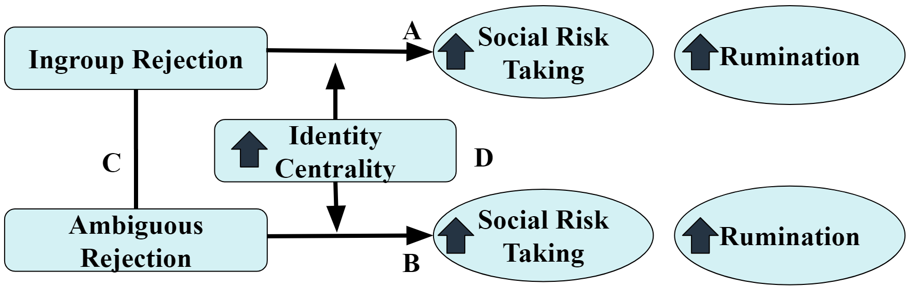
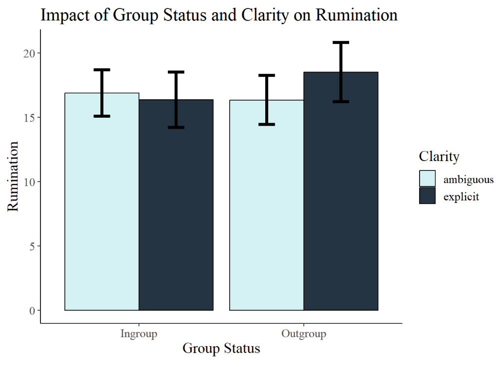
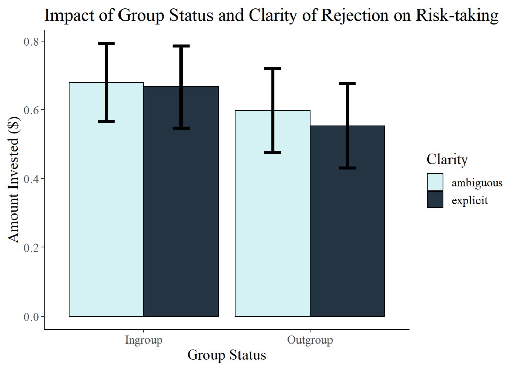
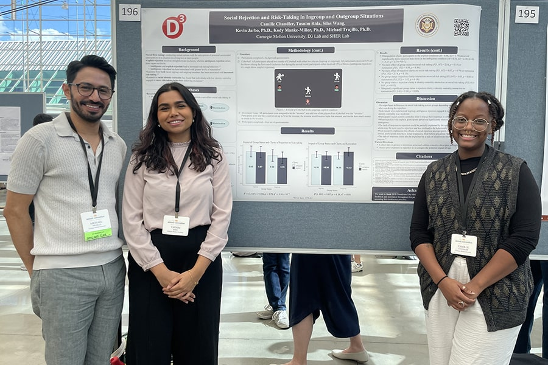

```{=html}
<link rel="stylesheet" href="https://cdn.jsdelivr.net/npm/bootstrap-icons@1.11.3/font/bootstrap-icons.css">
<link href="https://fonts.googleapis.com/css2?family=Fraunces:wght@400;500;600;700&family=Inter:wght@400;500;600;700&display=swap" rel="stylesheet">

<style>

:root {
  --bg: #f4f4f4;
  --black: #111;
  --white: #ffffff;
  --purple: #D85CDB;
  --green: #b7ff91;
  --soft-purple: #F7E8F8;
}

html,
body {
  margin: 0;
  padding: 0;
}

body {
  background: var(--bg);
  overflow-x: hidden;
  color: var(--black);
}

#quarto-content,
#quarto-document-content,
.page-columns,
.content,
main.content {
  width: 100% !important;
  max-width: 100% !important;
  margin: 0 !important;
}

main.content {
  padding: 0 !important;
  padding-bottom: 0 !important;
}

.quarto-title-block {
  display: none !important;
}

/* remove Quarto/Cosmo grey heading underlines and link underlines */
.poster-page h1,
.poster-page h2,
.poster-page h3 {
  border: none !important;
  border-bottom: none !important;
  padding-bottom: 0 !important;
  box-shadow: none !important;
}

.poster-page hr {
  display: none;
}

.poster-page a {
  text-decoration: none;
}

/* ---------------- POSTER CANVAS ---------------- */

.poster-page {
  width: min(1100px, calc(100vw - 1rem));
  margin: 1rem auto 0;
  background: var(--bg);
  padding: 3rem 2rem 3rem;
  box-sizing: border-box;
  font-family: "Inter", sans-serif;
  color: var(--black);
}

.poster-main {
  display: flex;
  flex-direction: column;
  gap: 5rem;
}

/* ---------------- HEADER ---------------- */

.poster-header {
  text-align: center;
  max-width: 860px;
  margin: 0 auto 4.5rem;
}

.poster-header h1 {
  font-family: "Fraunces", serif;
  font-size: clamp(1.8rem, 3vw, 2.45rem);
  line-height: 1.08;
  font-weight: 400;
  margin: 0 0 1rem;
  letter-spacing: 0;
  color: var(--black);
}

.poster-header p {
  font-family: "Inter", sans-serif;
  font-size: 0.95rem;
  line-height: 1.18;
  max-width: 680px;
  margin: 0 auto 0.8rem;
  color: var(--black);
}

.poster-date {
  font-family: "Inter", sans-serif;
  font-size: 0.9rem;
  margin-bottom: 1.6rem;
  color: var(--black);
}

.nav-buttons {
  display: flex;
  justify-content: center;
  gap: 1.2rem;
}

.nav-buttons a {
  font-family: "Inter", sans-serif;
  color: var(--black);
  text-decoration: none;
  font-size: 1.15rem;
  width: 2.8rem;
  height: 2.8rem;

  display: inline-flex;
  align-items: center;
  justify-content: center;

  border: 2px solid var(--black);
  border-radius: 999px;
  background: var(--white);
  box-shadow: 5px 5px 0 var(--green);

  transition: transform 0.18s ease, box-shadow 0.18s ease, background 0.18s ease;
}

.nav-buttons a:hover {
  color: var(--black);
  background: var(--green);
  box-shadow: 5px 5px 0 var(--purple);
  transform: translateY(-2px);
}

.nav-buttons i {
  line-height: 1;
}

/* ---------------- SECTION HEADINGS (TWO FLOWERS) ---------------- */

.flower-heading {
  display: flex;
  align-items: center;
  justify-content: center;
  gap: 1rem;
  margin: 0 auto 1.75rem auto;

  font-family: "Fraunces", serif;
  font-size: clamp(1.5rem, 2.55vw, 2.25rem);
  font-weight: 400;
  line-height: 1;
  color: var(--black);
}

.flower-heading img {
  width: 48px;
  height: 48px;
  object-fit: contain;
  display: block;
}

/* ---------------- RESEARCH QUESTION ---------------- */

.question-section {
  max-width: 760px;
  margin: 0 auto;
  text-align: center;
}

.question {
  font-family: "Fraunces", serif;
  font-size: clamp(1rem, 1.5vw, 1.3rem);
  line-height: 1.25;
  font-weight: 400;
  margin: 0 auto 1.5rem;
  color: var(--black);
}

.question-section p {
  font-family: "Inter", sans-serif;
  font-size: 1rem;
  line-height: 1.55;
  margin: 0;
  color: var(--black);
}

/* ---------------- METHODOLOGY ---------------- */

.methodology-section {
  width: 100%;
}

.methodology-body {
  display: grid;
  grid-template-columns: 1fr 1fr;
  column-gap: 3.5rem;
  align-items: center;
}

.methodology-text p,
.methodology-text li {
  font-family: "Inter", sans-serif;
  font-size: 1rem;
  line-height: 1.5;
  color: var(--black);
}

.methodology-text p {
  margin: 0;
}

.methodology-text ul {
  padding-left: 1.2rem;
  margin: 1rem 0 0;
}

.methodology-text li {
  margin-bottom: 0.5rem;
}

.methodology-text li:last-child {
  margin-bottom: 0;
}

.plain-plot img {
  width: 100%;
  display: block;
  border-radius: 16px;
  object-fit: contain;
}

/* ---------------- KEY FINDINGS (2 x 2) ---------------- */

.key-findings-section {
  width: 100%;
}

.findings-grid {
  display: grid;
  grid-template-columns: 1fr 1fr;
  column-gap: 3rem;
  row-gap: 1.25rem;          /* gap between text row and plot row */
  align-items: start;
}

.finding {
  display: grid;
  grid-template-columns: 64px 1fr;
  column-gap: 1.1rem;
  align-items: start;

  /* each finding spans 2 rows of the parent grid, so the top two
     findings' text rows match in height and their plots line up */
  grid-row: span 2;
  grid-template-rows: subgrid;
}

.finding-icon {
  width: 64px;
  height: 64px;
  border-radius: 50%;
  background: #efffe8;

  display: flex;
  align-items: center;
  justify-content: center;
}

.finding-icon svg {
  width: 36px;
  height: 36px;
  stroke: var(--black);
  stroke-width: 2.3;
  fill: none;
  stroke-linecap: round;
  stroke-linejoin: round;
}

.finding-icon .purple-fill {
  fill: var(--purple);
  stroke: var(--black);
}

.finding-label {
  margin: 0 0 0.4rem 0;
  font-family: "Inter", sans-serif;
  font-size: 1.05rem;
  font-weight: 800;
  line-height: 1.15;
  color: var(--black);
  text-decoration: none;
  pointer-events: none;
}

.finding-text p {
  margin: 0;
  font-family: "Inter", sans-serif;
  font-size: 0.92rem;
  line-height: 1.5;
  color: var(--black);
}

.finding-plot {
  grid-column: 1 / -1;
}

.finding-plot img {
  width: 100%;
  display: block;
  border-radius: 16px;
  object-fit: contain;
}

/* ---------------- FINAL IMAGE + NOTE (NO BOX) ---------------- */

.presentation-row {
  display: grid;
  grid-template-columns: 0.9fr 1.1fr;
  column-gap: 2.5rem;
  align-items: center;
  width: 100%;
  max-width: 850px;
  margin: 0 auto;
}

.presentation-row img {
  width: 100%;
  display: block;
  border-radius: 20px;
}

.presentation-note {
  font-family: "Inter", sans-serif;
  font-size: 0.95rem;
  line-height: 1.5;
  text-align: left;
  color: var(--black);
  margin: 0;
}

/* ---------------- MOBILE ---------------- */

@media (max-width: 760px) {
  .poster-page {
    width: 100%;
    margin: 0;
    padding: 2rem 1rem 2rem;
  }

  .poster-main {
    gap: 3.5rem;
  }

  .poster-header {
    margin-bottom: 2.5rem;
  }

  .nav-buttons {
    gap: 0.9rem;
    flex-wrap: wrap;
  }

  .flower-heading {
    gap: 0.75rem;
  }

  .flower-heading img {
    width: 28px;
    height: 28px;
  }

  .methodology-body {
    grid-template-columns: 1fr;
    row-gap: 2rem;
  }

  .findings-grid {
    grid-template-columns: 1fr;
    row-gap: 1.25rem;
  }

  .finding {
    grid-template-columns: 52px 1fr;
    column-gap: 1rem;
  }

  .finding-icon {
    width: 52px;
    height: 52px;
  }

  .finding-icon svg {
    width: 30px;
    height: 30px;
  }

  .presentation-row {
    grid-template-columns: 1fr;
    row-gap: 1.5rem;
  }

  .presentation-note {
    text-align: center;
  }
}

</style>

<div class="poster-page">

  <header class="poster-header">
    <h1>Social Rejection and Risk-Taking in Ingroup and Outgroup Situations</h1>

    <p>
      A behavioral study examining how social rejection influences risk-taking behavior across varying levels of rejection clarity and group identity.
    </p>

    <div class="poster-date">March 2024</div>

    <nav class="nav-buttons">
      <a href="https://www.cmu.edu/dietrich/psychology/sherlab/publications/pdf/sbs-poster.pdf" aria-label="Poster" title="Poster">
        <i class="bi bi-file-earmark-image"></i>
      </a>
    </nav>
  </header>

  <main class="poster-main">

    <!-- RESEARCH QUESTION -->

    <section class="question-section">
      <div class="flower-heading">
        
        <span>Research Question</span>
        
      </div>

      <div class="question">
        How does an ambiguous (vs. explicit) social rejection event affect social risk-taking in ingroup and outgroup situations?
      </div>
    </section>

    <!-- METHODOLOGY + PLOT 2 -->

    <section class="methodology-section">
      <div class="flower-heading">
        
        <span>Methodology</span>
        
      </div>

      <div class="methodology-body">
        <div class="methodology-text">
          <p>
            The study employed a 2 × 2 between-subjects experimental design to examine how different social rejection contexts influence behavior and affect.
          </p>
          <ul>
            <li>Group status was manipulated as ingroup versus outgroup.</li>
            <li>Rejection clarity was manipulated as ambiguous versus explicit.</li>
            <li>Social rejection was modeled using a modified Cyberball paradigm, an online ball-tossing game commonly used to study social exclusion.</li>
            <li>Participants then completed a behavioral social risk-taking task and self-report measures assessing rumination, self-esteem, and negative affect.</li>
          </ul>
        </div>

        <div class="plain-plot">
          
        </div>
      </div>
    </section>

    <!-- KEY FINDINGS (2 x 2) -->

    <section class="key-findings-section">

      <div class="flower-heading">
        
        <span>Key Findings</span>
        
      </div>

      <div class="findings-grid">

        <!-- Row 1, left: Group Status Effect + PLOT 4 -->
        <div class="finding">
          <div class="finding-icon">
            <svg viewBox="0 0 64 64" aria-hidden="true">
              <path d="M10 52h44"></path>
              <path d="M14 43l10-11 9 7 16-22"></path>
              <circle cx="14" cy="43" r="3.2" class="purple-fill"></circle>
              <circle cx="24" cy="32" r="3.2" class="purple-fill"></circle>
              <circle cx="33" cy="39" r="3.2" class="purple-fill"></circle>
              <circle cx="49" cy="17" r="3.2" class="purple-fill"></circle>
              <path d="M14 16h14"></path>
              <path d="M14 23h20"></path>
              <path d="M14 9h26"></path>
            </svg>
          </div>

          <div class="finding-text">
            <div class="finding-label">Group Status Effect</div>
            <p>
              Rejection from ingroup versus outgroup members did not produce significant differences in social risk-taking or rumination.
            </p>
          </div>

          <div class="finding-plot">
            
          </div>
        </div>

        <!-- Row 1, right: Rejection Clarity Effect + PLOT 3 -->
        <div class="finding">
          <div class="finding-icon">
            <svg viewBox="0 0 64 64" aria-hidden="true">
              <path d="M12 52h40"></path>
              <rect x="16" y="37" width="7" height="15"></rect>
              <rect x="29" y="28" width="7" height="24"></rect>
              <rect x="42" y="18" width="7" height="34"></rect>
              <path class="purple-fill" d="M28 8.5l3 6.1 6.7 1-4.9 4.8 1.2 6.8-6-3.2-6 3.2 1.2-6.8-4.9-4.8 6.7-1 3-6.1z"></path>
            </svg>
          </div>

          <div class="finding-text">
            <div class="finding-label">Rejection Clarity Effect</div>
            <p>
              While rejection clarity shaped participants’ perception of exclusion, it did not translate into significant differences in social risk-taking or rumination.
            </p>
          </div>

          <div class="finding-plot">
            
          </div>
        </div>

        <!-- Row 2, left: Manipulation check (no plot) -->
        <div class="finding">
          <div class="finding-icon">
            <svg viewBox="0 0 64 64" aria-hidden="true">
              <circle cx="24" cy="29" r="5.5"></circle>
              <circle cx="40" cy="29" r="5.5"></circle>
              <circle cx="32" cy="22" r="6"></circle>
              <path d="M14 49c1.3-8 6.5-12.5 13-12.5"></path>
              <path d="M50 49c-1.3-8-6.5-12.5-13-12.5"></path>
              <path d="M22 51c1-9 6-14.5 10-14.5s9 5.5 10 14.5"></path>
              <path class="purple-fill" d="M32 13s-6.5-3.8-6.5-8.2c0-2.3 1.7-4 4-4 1.3 0 2.5.7 3.2 1.9C33.4 1.5 34.6.8 36 .8c2.3 0 4 1.7 4 4C40 9.2 32 13 32 13z"></path>
            </svg>
          </div>

          <div class="finding-text">
            <div class="finding-label">Manipulation Check</div>
            <p>
              The experimental manipulation was successful, with participants in the explicit condition reporting significantly higher perceived rejection than those in the ambiguous condition.
            </p>
          </div>
        </div>

        <!-- Row 2, right: Moderator effect (no plot) -->
        <div class="finding">
          <div class="finding-icon">
            <svg viewBox="0 0 64 64" aria-hidden="true">
              <path d="M32 8v48"></path>
              <path d="M18 20h28"></path>
              <path d="M22 32h20"></path>
              <path d="M26 44h12"></path>
              <circle cx="32" cy="8" r="4" class="purple-fill"></circle>
              <circle cx="18" cy="20" r="3.2" class="purple-fill"></circle>
              <circle cx="46" cy="20" r="3.2" class="purple-fill"></circle>
              <circle cx="22" cy="32" r="3.2" class="purple-fill"></circle>
              <circle cx="42" cy="32" r="3.2" class="purple-fill"></circle>
              <circle cx="26" cy="44" r="3.2" class="purple-fill"></circle>
              <circle cx="38" cy="44" r="3.2" class="purple-fill"></circle>
            </svg>
          </div>

          <div class="finding-text">
            <div class="finding-label">Moderator Effect</div>
            <p>
              A marginal effect suggested that individuals with moderate identity centrality may be more psychologically responsive, particularly in terms of rumination, when experiencing ambiguous rejection from ingroup members.
            </p>
          </div>
        </div>

      </div>
    </section>

    <!-- PIC 2 + NOTE (no box) -->

    <section class="presentation-row">
      

      <p class="presentation-note">
        This research was conducted as part of Dr. Michael Trujillo’s Stigma, Health Equity, and Resilience Lab at Carnegie Mellon University. Findings were presented at the Society for Personality and Social Psychology 2024 Annual Convention and selected as the winning poster for CMU Psychology Department’s Meeting of the Minds 2024.
      </p>
    </section>

  </main>

</div>
```